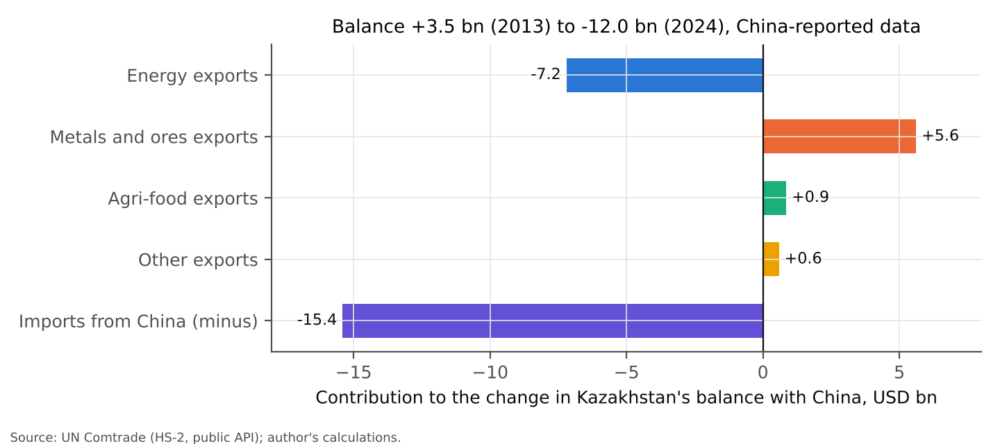
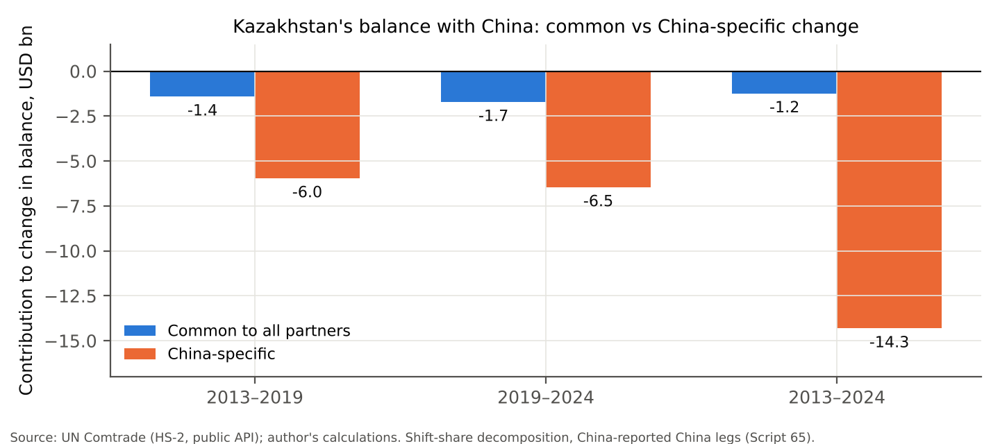
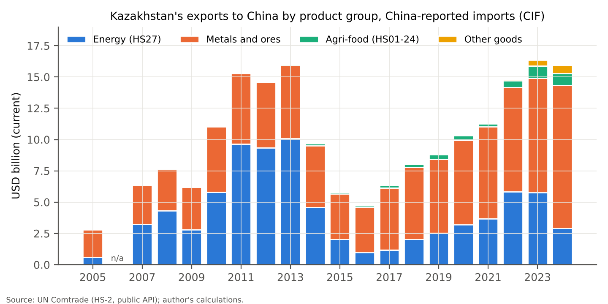
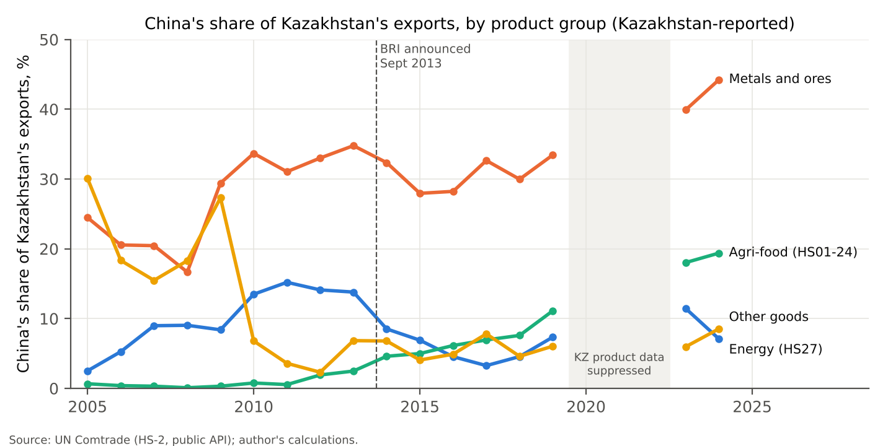
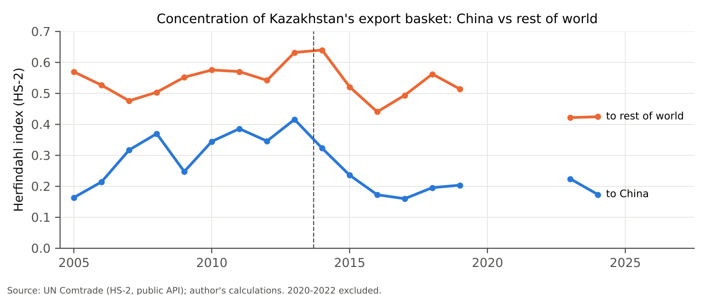
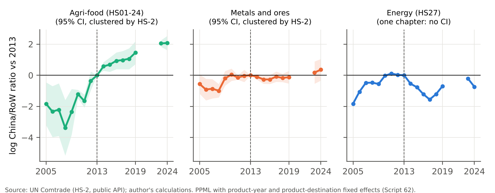
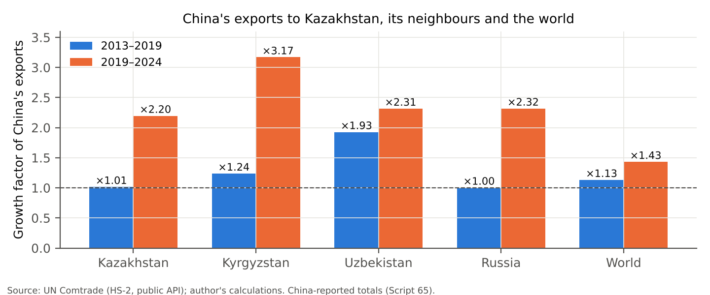
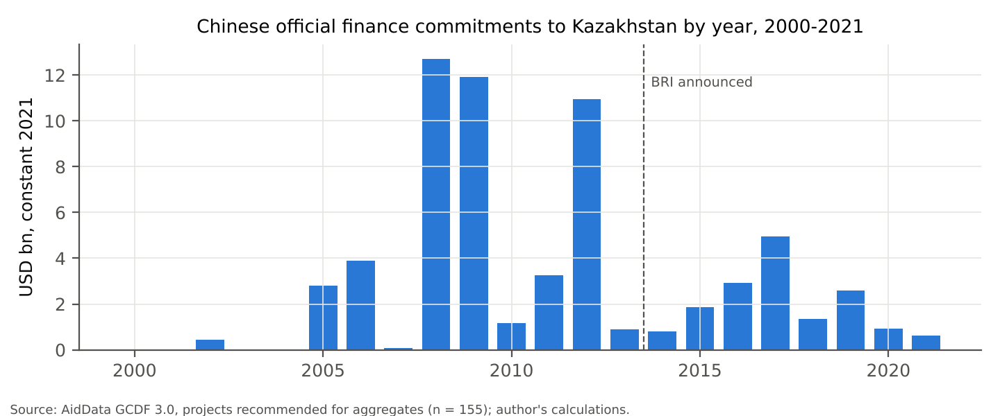

# Abstract

Between 2013, when the Belt and Road Initiative (BRI) was announced in Astana, and 2024, Kazakhstan's trade balance with China moved from a surplus of USD 3.5 billion to a deficit of USD 12.0 billion (China-reported data). This thesis asks one question: **how much of that deterioration was specific to Kazakhstan's relationship with China, and does the bilateral part match the mechanisms through which the BRI was expected to act, in particular through strategic mineral exports?** The BRI can only have affected the balance through changes that are specific to the bilateral relationship; changes that also occurred in Kazakhstan's trade with every other partner, such as the oil price collapse, cannot be BRI effects. Separating the two parts therefore puts an upper bound on what the BRI could explain, and testing the timing and composition of the bilateral part shows how much of that bound actually fits BRI mechanisms.

The thesis builds an HS-2 panel of Kazakhstan's exports to China and to the rest of the world for 2005–2024 from UN Comtrade, validated against China's mirror records and World Bank totals, and adds aggregate import data, China's exports to neighbouring countries and AidData records of Chinese official finance. A shift-share decomposition splits each flow into a component common to Kazakhstan's trade with all partners and a China-specific component. PPML triple-difference, event-study and trend-break models, with Holm corrections and randomisation inference, test which export groups changed specifically towards China and when.

The analysis applies two benchmarks in turn. Against Kazakhstan's trade with its other partners, about 92 per cent of the 2013–2024 deterioration (USD 14.3 of 15.5 billion) is China-specific, in either country's data: the commodity cycle explains little, and the BRI is a legitimate candidate. Against China's trade with Kazakhstan's neighbours, the largest part of that China-specific change disappears: imports from China rose by USD 14.1 billion more than Kazakhstan's imports from other suppliers, but no faster than China's exports to Russia, Kyrgyzstan and Uzbekistan, and mostly after 2022. What remains specific to the Kazakhstan–China pair is on the export side, and it nets to about zero (−USD 0.2 billion): a China-specific fall in oil exports (−USD 4.9 billion), which runs opposite to the BRI's resource-security mechanism, offset by China-specific gains in other exports. Strategic mineral exports were a China-specific *stabiliser* of the balance (+USD 3.4 billion), but almost entirely after 2019. The one component that fits a BRI mechanism, the reorientation of agri-food exports towards China, is robust to multiple-testing correction and randomisation inference, but it is small (+USD 0.8 billion), began before 2013 and did not accelerate after it. Chinese official finance peaked before the BRI.

The deterioration is therefore not, at its core, a Kazakhstan–China story: it is a post-2022 regional import surge plus pair-specific export changes that roughly cancel. The BRI is the correct frame for testing this, but the evidence does not support attributing the deterioration to BRI mechanisms. It also documents that Kazakhstan's 2020–2022 partner statistics omit major metal exports and machinery imports.

**Keywords:** Belt and Road Initiative; Kazakhstan–China trade balance; strategic minerals; shift-share decomposition; PPML; mirror statistics; Central Asia

# 1. Introduction

## 1.1 The Phenomenon

China is one of Kazakhstan's two most important trading partners. In 2023 it supplied 27.4 per cent of Kazakhstan's imports and took 18.7 per cent of its exports [@bns_2024_foreign_trade]. Kazakhstan is also where the BRI began: Xi Jinping proposed the Silk Road Economic Belt at Nazarbayev University in Astana on 7 September 2013 [@xinhua_chinadaily_2013]. Since then a dry port at Khorgos on the border has started operating (2015), with Chinese state companies taking a 49 per cent stake in 2017 [@ktze_khorgos_2025]; Chinese policy banks have financed road reconstruction across the country [@aiddata_gcdf3_2023]; and the two governments have signed protocols that open the Chinese market to Kazakh agricultural products [@astanatimes_agri_2023].

Over the same period Kazakhstan's trade balance with China deteriorated. By China's reported data, a surplus of USD 3.5 billion in 2013 became a deficit of USD 3.9 billion in 2019 and USD 12.0 billion in 2024 (Table 6.1). The composition of trade also changed: oil fell from 62 to 22 per cent of Kazakhstan's exports to China, metals and ores rose from 36 to 67 per cent, and imports from China more than doubled after 2019.

## 1.2 The Puzzle

The BRI was presented in both countries as a project that would strengthen Kazakhstan's position: better transport links to China, Chinese investment in Kazakh production and wider access to the Chinese market. Kazakhstan's main asset in this relationship was its strategic minerals: uranium, copper, ores and ferroalloys, for which Chinese demand was growing. Yet in the BRI era Kazakhstan's balance with China deteriorated by USD 15.5 billion.

Two very different explanations are possible. The deterioration may be **bilateral**: something changed in the Kazakhstan–China relationship itself, and the BRI, as the main bilateral framework of the period, is the natural candidate. Or it may be the **bilateral reflection of general shocks**: the 2014–2016 collapse of oil and metal prices and the changes in regional trade after 2022 affected Kazakhstan's trade with every partner, and the bilateral balance with China would have moved even without any change in the relationship. Before-and-after comparisons, which are common in discussion of the BRI in Kazakhstan, cannot tell these apart, because both explanations predict a deterioration after 2013. This is the puzzle: **a bilateral outcome changed in the BRI era, but it is not known whether the change was bilateral at all, and if it was, whether it took the form the BRI's mechanisms imply.**

## 1.3 Research Question

> **Central research question.** *How much of the BRI-era deterioration in Kazakhstan's trade balance with China was specific to the bilateral relationship, and does the timing and composition of that bilateral component match the mechanisms through which the BRI was expected to operate, in particular through strategic mineral exports?*

The question has two parts that depend on each other. The first part asks for an **upper bound**: the BRI, like any bilateral factor, can only have acted through the China-specific component of the change, so the size of that component limits what the BRI could explain. The second part asks whether the bilateral component **fits** BRI mechanisms. The BRI was expected to work through two channels (Chapter 3): connectivity and market access, which should raise trade in goods previously little traded with China, and resource finance, which should raise China-oriented exports of energy and minerals. Each predicts which products change and when.

Four sub-questions organise the analysis. Each answers one step of the central question:

- **SQ1 (size of the bilateral component).** How much of the change in the balance, its exports and its imports, is common to Kazakhstan's trade with all partners, and how much is China-specific? (§6.1–6.2)
- **SQ2 (export side: fit with BRI mechanisms).** Which export groups, including strategic minerals, changed specifically towards or away from China, and did those changes begin with the BRI? (§6.3–6.5)
- **SQ3 (import side: fit with BRI mechanisms).** Is the China-specific rise in imports specific to Kazakhstan, and when did it occur? (§6.6)
- **SQ4 (mechanism evidence).** Do the timing and sectors of measurable BRI channels (Chinese finance, transport and border infrastructure, market access) match the components found under SQ2–SQ3? (§6.8)

A data question is not a separate research question but a precondition: the China-specific component is exactly what statistical discrepancies between the two countries distort, so the reliability of the bilateral statistics is examined first (Chapter 4).

## 1.4 Why the BRI Is Central, and at What Level

The BRI is not used here as a label for the period. It is central for three reasons.

1. **It is the hypothesis that defines the question.** The reason to ask whether the deterioration was bilateral is that the BRI is a bilateral and regional framework; if the change were entirely common to all partners, the BRI would be irrelevant to it, and the thesis would show that. It is not: relative to Kazakhstan's other partners the change is overwhelmingly China-specific (§6.2), which makes the BRI a serious candidate and the second part of the question necessary. Because the BRI is also a regional initiative, the thesis then asks whether the China-specific change is specific to Kazakhstan or shared with China's other neighbours, and uses timing to judge whether any regional change could be a BRI effect (§6.6).
2. **It generates testable mechanisms.** The BRI literature specifies how the initiative should affect trade: through lower trade costs and market access, and through Chinese finance for resource and infrastructure projects (Chapter 2). These imply specific predictions about which products and which years should change, and the thesis tests them.
3. **The conclusion is about the BRI.** The thesis ends with a statement about how much of the bilateral deterioration the BRI could have caused and how much of it fits BRI mechanisms. A negative or limited answer is still an answer about the BRI.

Three levels of claim are distinguished throughout:

- **A. Context.** The BRI is the policy framework of the period.
- **B. Consistency with BRI mechanisms.** A China-specific change whose products and timing match a BRI mechanism.
- **C. Causal effect.** A change that would not have happened without the BRI.

The design reaches level B. It cannot reach level C, because China-specific changes caused by the BRI cannot be separated from China-specific changes caused by China's own demand or other bilateral factors (§5.6). The thesis therefore uses the China-specific component as an *upper bound* on any BRI effect and never claims level C.

## 1.5 Aim and Objectives

**Aim.** To determine how much of the BRI-era deterioration in Kazakhstan's balance with China was bilateral and how much of the bilateral part fits BRI mechanisms, including the role of strategic mineral exports.

**Objectives.**

1. To derive, from the literature, the mechanisms through which the BRI was expected to affect Kazakhstan–China trade and their testable implications (Chapters 2–3).
2. To build and validate a dataset in which the bilateral component can be measured reliably, reconciling Kazakh and Chinese statistics (Chapter 4).
3. To split the change in the bilateral balance into common and China-specific components (§6.1–6.2).
4. To test which export groups, including strategic minerals, changed specifically towards China, and when (§6.3–6.5).
5. To establish whether the China-specific import rise is specific to Kazakhstan and when it occurred (§6.6).
6. To compare the timing and sectors of BRI channels with these components, and to state what the BRI can and cannot explain (§6.8, Chapters 7–8).

**Object and subject.** The *object* is Kazakhstan–China bilateral trade. The *subject* is the bilateral (China-specific) component of the change in the trade balance and its relationship to BRI mechanisms and strategic mineral exports.

## 1.6 Contribution

The thesis makes one main contribution and three supporting ones.

**Main contribution: a two-benchmark bound and a mechanism test for the BRI's role in the bilateral balance.** The thesis shows that the BRI-era deterioration was overwhelmingly China-specific relative to Kazakhstan's other partners (about 92 per cent), so it cannot be dismissed as the commodity cycle. It then shows that the largest China-specific component, the import surge, is not specific to Kazakhstan when compared with China's exports to Kazakhstan's neighbours, and that it came after 2022. What is specific to the Kazakhstan–China pair, the export side, nets to about zero and is made of components whose timing or direction contradict BRI mechanisms (oil) or that improved the balance (strategic minerals, agri-food). This replaces an untestable claim ("the BRI affected the balance") with a measured statement of how much it *could* have affected and how much is *consistent* with it.

**Supporting contributions.**

1. *Strategic minerals.* Strategic mineral exports were a China-specific stabiliser of the balance (+USD 3.4 billion, 2013–2024), but almost entirely after 2019, not in the main BRI construction period.
2. *Agri-food.* The only export reorientation that fits a BRI mechanism (market access) began before 2013 and did not accelerate after it; this is robust to multiple-testing correction and randomisation inference.
3. *Statistics.* Kazakhstan's partner-level statistics for 2020–2022 omit copper, zinc and aluminium exports and machinery, electrical and vehicle imports; the bilateral component cannot be measured without China's mirror data.

**Practical significance.** The results show that the balance with China should be monitored by component and against other partners and neighbours; that its recent deterioration is mainly a regional import phenomenon after 2022; that strategic minerals supported rather than weakened the balance; and that the national statistics need reconciliation with partner data.

**Provisions submitted for defence.**

1. About 92 per cent of the 2013–2024 deterioration in Kazakhstan's balance with China (USD 14.3 of 15.5 billion, China-reported) is China-specific relative to Kazakhstan's other partners; the same share appears in Kazakhstan's own data.
2. Most of that China-specific change is an import surge after 2022 that is not specific to Kazakhstan: China's exports to Russia, Kyrgyzstan and Uzbekistan grew as fast or faster. The changes specific to the Kazakhstan–China pair are on the export side and net to about zero; the largest of them, a fall in oil exports to China, runs opposite to the BRI's resource-security mechanism.
3. Strategic mineral exports were a China-specific stabiliser of the balance, mostly after 2019; the agri-food reorientation is the only component consistent with a BRI mechanism, and it began before 2013.
4. The BRI is supported as the context of a bilateral change (level A) and as consistent with the agri-food component (level B); a BRI cause of the deterioration (level C) is not supported.

## 1.7 Structure

Chapter 2 reviews the literature on the BRI's expected mechanisms and on Kazakhstan–China trade. Chapter 3 turns the mechanisms into predictions about the bilateral component. Chapter 4 builds and validates the data, which is necessary because the bilateral component is sensitive to reporting differences. Chapter 5 sets out the decomposition, the tests and the safeguards against multiple testing and missing data. Chapter 6 answers the sub-questions in order and ends with a synthesis table (Table 6.14) that maps every result to the central question. Chapter 7 interprets the answer, including for strategic minerals and for the interdependence debate. Chapter 8 concludes.

# 2. Literature Review

## 2.1 Resource-Based Trade and the Comparative-Advantage Null

Standard trade theory predicts that a resource-abundant economy such as Kazakhstan exports resource-intensive goods and imports manufactures from a labour- and capital-abundant economy such as China [@ricardo_1817; @heckscher_1919; @ohlin_1933]. In that framework neither the bilateral balance nor the share of a particular partner has welfare significance in itself. What matters for this thesis is the empirical implication: if Kazakhstan's comparative advantage and world prices determine what it exports, the composition of its exports should change in the same way for every destination. Any change in the composition of exports to China would then reflect world prices and Kazakhstan's own supply, not anything specific to China. This is the null hypothesis against which BRI-related claims must be tested.

The commodity-dependence literature explains why that null is demanding. Commodity prices are volatile and have long cycles [@harvey_etal_2010], resource booms affect the real exchange rate and non-resource sectors [@corden_neary_1982], and the developmental consequences of resource wealth depend on institutions and policy [@sachs_warner_1995; @vanderploeg_2011; @frankel_2010]. Export growth driven by resource volume can even reduce welfare when it worsens the terms of trade [@bhagwati_1958]. For Kazakhstan, the 2014–2016 oil price collapse alone could produce large changes in export composition, the bilateral balance and the exchange rate without any change in trade costs with China.

## 2.2 Trade Costs, Gravity and the BRI

Gravity models explain bilateral trade by economic size and bilateral trade costs relative to the trade costs each country faces with all partners [@anderson_vanwincoop_2003]. Poisson pseudo-maximum-likelihood (PPML) estimation of such models is now standard because it handles zero flows and heteroskedasticity [@santos_silva_tenreyro_2006]. The BRI literature applies this framework. De Soyres et al. [-@desoyres_etal_2019; -@desoyres_etal_2020] estimate that BRI transport projects reduce shipping times and trade costs, with gains concentrated along corridors. Baniya, Rocha and Ruta [-@baniya_rocha_ruta_2020] find that BRI-related improvements raise trade flows, more so when infrastructure is complemented by trade-policy reforms. Bird, Lebrand and Venables [-@bird_lebrand_venables_2020] model Central Asia specifically and show that gains from improved connectivity are uneven across locations and sectors.

Two limits of this literature matter here. First, most estimates are simulations or cross-country averages; they do not test what happened in one country pair. Second, they predict *more trade*, not a particular balance or composition. The trade-cost channel has a compositional implication only through the next strand of theory: lower trade costs matter most for products that were previously not traded or were traded little.

## 2.3 The Margins of Export Growth and Diversification

Models with heterogeneous firms imply that lower trade costs allow new, less productive firms and new products to enter a market [@melitz_2003], so that bilateral trade responds to trade costs mainly through the *extensive margin* of new products and firms [@chaney_2008]. Across countries, larger exporters export more varieties [@hummels_klenow_2005]. Diversification also follows a development pattern: production and exports diversify as income rises and re-concentrate only at high income levels [@imbs_wacziarg_2003; @cadot_carrere_strausskahn_2011]. These studies give the BRI trade-cost argument a specific, testable form: if BRI connectivity lowered the cost of reaching China, the gains should be largest for products that Kazakhstan exported little to China before, especially perishable or time-sensitive goods such as food, and the number of products exported to China should rise relative to other markets.

## 2.4 Chinese Finance and Resource Projects

A separate strand concerns Chinese official finance. China has become the largest official creditor to developing countries [@horn_reinhart_trebesch_2021], and BRI lending raised debt-sustainability concerns in several corridor economies [@hurley_morris_portelance_2018], although claims of systematic "debt-trap diplomacy" are not supported by the evidence [@brautigam_2020]. AidData's Global Chinese Development Finance Dataset records Chinese official commitments project by project for 2000–2021 [@aiddata_gcdf3_2023; @custer_etal_2023]. For Kazakhstan, the relevant question is whether Chinese finance went into export capacity, for instance mines and processing, and whether that capacity was then oriented towards China. Jepson and Baldakova [-@jepson_2024] study whether Chinese state capital supported resource-based structural transformation in Bolivia and Kazakhstan, and Calabrese [-@calabrese_2024] asks the same question for diversification in the Kyrgyz Republic. Global value chain research adds that suppliers in captive relationships often have limited scope for upgrading [@gereffi_humphrey_sturgeon_2005].

## 2.5 Kazakhstan, Central Asia and China

Area studies emphasise that the BRI in Central Asia is a broad label applied to projects, agreements and diplomatic initiatives of very different kinds [@laruelle_2018; @cooley_2012]. Pomfret [-@pomfret_2019] documents how Central Asian trade has been shaped by transport costs, trade policy and the Eurasian Economic Union, not only by China. Laruelle and Peyrouse [-@laruelle_peyrouse_2012] and Grant [-@grant_2020] show that the Chinese presence is received ambivalently in Kazakhstan, and Primiano and Kudebayeva [-@primiano_kudebayeva_2025] find uneven views of the BRI among Kazakh students. Rolland [-@rolland_2017] and Swaine [-@swaine_2015] describe the strategic purposes China attaches to the initiative. This literature is a warning against treating "the BRI" as a single treatment with a single start date.

## 2.6 Asymmetric Interdependence

Keohane and Nye [-@keohane_nye_1977] distinguish *sensitivity*, how quickly changes in one economy affect another, from *vulnerability*, the cost of adjusting when a relationship is disrupted. Hirschman [-@hirschman_1945] showed that trade can become a source of influence for the larger partner when the smaller partner's trade is concentrated on it and hard to redirect. This framework is frequently invoked for Kazakhstan–China relations. It does not, however, predict that trade concentration is harmful, or that it will be used as leverage; it predicts that the costs of disruption are distributed according to who can substitute more easily. Whether that is the case is an empirical question about both sides of the relationship, which most applications do not measure.

## 2.7 Research Gap

The literature supplies BRI mechanisms (trade costs and market access; resource finance) and a null (comparative advantage and commodity prices), but, among the studies reviewed here, none asks how much of the change in Kazakhstan's bilateral balance with China is bilateral at all, or tests whether the bilateral part has the product composition and timing those mechanisms imply. None checks the bilateral statistics on which such conclusions depend. This thesis fills these gaps for one country pair; it does not claim to estimate the BRI's effect in general.

# 3. Theoretical Framework and Expectations

## 3.1 Framework: Common and Bilateral Components

Following the structural gravity view of bilateral trade [@anderson_vanwincoop_2003], Kazakhstan's exports of product *p* to destination *d* in year *t*, and its imports, depend on three sets of factors:

1. **Factors common to all partners** for that product and year: world prices, Kazakhstan's output and income, its exchange rate and its trade policy. The 2014–2016 oil price collapse belongs here.
2. **Persistent features of each bilateral relationship:** distance, pipelines and rail links that existed before 2013, long-standing contracts.
3. **Changes specific to one partner over time.** For China these include BRI-era infrastructure and border facilitation, market-access agreements, Chinese finance, China's own import demand and export supply, and regional shocks that affected China's trade with Kazakhstan differently from Kazakhstan's trade with others.

The BRI can only act through the third set. The empirical strategy therefore first measures the third set (the China-specific component) and then asks whether its composition and timing match the BRI's mechanisms. Because the third set also contains non-BRI factors, the China-specific component is an upper bound on any BRI effect, not an estimate of it.

## 3.2 BRI Mechanisms and Their Predictions

**M1. Connectivity and market access** [@desoyres_etal_2019; @baniya_rocha_ruta_2020; @bird_lebrand_venables_2020; @chaney_2008]. Lower trade costs and phytosanitary access should raise bilateral trade most where it was previously small: non-traditional exports such as food and manufactures, and imports of goods sensitive to transport time and cost. Timing: from 2014, with infrastructure milestones from 2015 (Khorgos dry port) onwards.

**M2. Resource finance and security** [@horn_reinhart_trebesch_2021; @jepson_2024]. Chinese finance for hydrocarbon and mining projects should raise Kazakhstan's China-oriented exports of energy and strategic minerals. Timing: after the relevant finance and project completion.

**Null (N0). Common shocks and comparative advantage** [@heckscher_1919; @ohlin_1933; @harvey_etal_2010]. Changes in Kazakhstan–China trade mirror changes in Kazakhstan's trade with all partners; the China-specific component is close to zero.

## 3.3 Expectations

| Component | N0 (common shocks) | M1 (connectivity, market access) | M2 (resource finance) |
|---|---|---|---|
| Size of China-specific share of the balance change | Small | Large | Large |
| Energy exports, China-specific | ≈ 0 | ≈ 0 | **Positive** |
| Strategic minerals exports, China-specific | ≈ 0 | ≈ 0 | **Positive**, after Chinese-financed projects |
| Agri-food and other exports, China-specific | ≈ 0 | **Positive**, from 2014–2015, accelerating | ≈ 0 |
| Imports from China, China-specific | ≈ 0 | **Positive**, from 2014–2015, Kazakhstan-specific relative to China's other partners | ≈ 0 |
| Timing | None | Break in trend after 2013 | After project completion |

A component is classed as **consistent with a BRI mechanism (level B)** only if it is China-specific, has the predicted sign and product composition, and begins or accelerates after 2013. A China-specific component that began earlier, did not accelerate, has the opposite sign, or is shared equally by China's trade with neighbouring countries is classed as *not attributable to BRI mechanisms on this evidence*.

## 3.4 How the Expectations Were Formed (Disclosure)

The general structure above (a common-shocks null against BRI connectivity and resource-finance mechanisms) was planned before the product-level data were collected. The product-group predictions in the table, however, were written after the author had inspected aggregate Kazakhstan–China data (in the earlier version of this thesis) **and** the descriptive shares by product group in the new panel (Table 6.6). The PPML tests were run after that inspection. The trend-break test, the shift-share decomposition and the import comparison with neighbouring countries were added in a second round of analysis, after the first results were reviewed. These elements are therefore partly exploratory. Chapter 5 (§5.7) describes the safeguards used: a small number of pre-defined product groups rather than a search across chapters, multiple-testing correction within each family of tests, randomisation inference, and the rule that only results surviving these checks are used in the answer to the central question.

## 3.5 Where Asymmetric Interdependence Fits

Asymmetric interdependence [@keohane_nye_1977; @hirschman_1945] is used in Chapter 7 to interpret the results, not as a hypothesis tested by them. The decomposition measures how trade changed; it does not measure bargaining power. Chapter 7 uses two-sided indicators of dependence to ask what the bilateral changes imply for each side, without assuming that concentration of trade with China implies Chinese leverage.

# 4. Data

## 4.1 Sources

All trade data come from the UN Comtrade database, retrieved through its public preview API on 31 October 2026 [@un_comtrade_hs2_2026]. Every value used is transcribed in a raw text file in `Collected_Raw_Data/raw_downloads/`, with the query URL, reporter, partner, flow, units and retrieval date in the file header (Appendix A). Table 4.1 lists the series.

**Table 4.1. Data series**

| Series | Reporter → partner | Flow | Valuation | HS level | Years | File |
|---|---|---|---|---|---|---|
| Kazakhstan's exports to China | Kazakhstan (398) → China (156) | Exports | FOB | HS-2 | 2005–2024 | `comtrade_hs2_kaz_exports_to_china.txt` |
| Kazakhstan's exports to the world | Kazakhstan → World (0) | Exports | FOB | HS-2 | 2005–2024 except 2020, 2022 | `comtrade_hs2_kaz_exports_to_world.txt` (+ gap-fill file) |
| China's imports from Kazakhstan (mirror) | China → Kazakhstan | Imports | CIF | HS-2 | 2005–2024 except 2006 | `comtrade_hs2_chn_imports_from_kaz.txt` |
| China's exports to Kazakhstan (mirror of Kazakhstan's imports) | China → Kazakhstan | Exports | FOB | HS-2 | 2013, 2019, 2024 | `comtrade_hs2_chn_exports_to_kaz.txt` |
| Kazakhstan's exports to Russia, HS 84, 85, 87 | Kazakhstan → Russia (643) | Exports | FOB | HS-2 | 2019, 2023 | `comtrade_hs2_kaz_exports_to_russia_selected.txt` |
| Merchandise exports, total | World Bank WDI | Exports | | Total | 2005–2024 | `wdi_kaz_merch_exports.csv` [@wdi_2026] |
| Kazakhstan's total imports from World and from China | Kazakhstan → World, China | Imports | CIF | Total | 2013, 2019, 2024 | `comtrade_totals_imports_and_china_exports.txt` |
| China's total exports to Kazakhstan, Kyrgyzstan, Uzbekistan, Russia, World | China → partners | Exports | FOB | Total | 2013, 2019, 2024 | same file |
| China's imports from World, selected chapters | China → World | Imports | CIF | HS-2 | 2024 | `comtrade_hs2_chn_imports_from_world_2024_selected.txt` |
| Chinese official finance commitments | AidData GCDF 3.0 | Commitments | Constant 2021 USD | Project | 2000–2021 | `aiddata_gcdf_v3.xlsx` [@aiddata_gcdf3_2023] |

*Values are in current US dollars unless stated. HS chapters are those reported (HS 2002 to HS 2022 vintages); chapter boundaries are stable across these vintages at the two-digit level.*

Data were retrieved year by year because the public API returns one period per call. Where the retrieval tool truncated a long response, the missing chapters were identified by comparison with neighbouring years and re-queried explicitly; these are recorded in a separate gap-fill file. One response (Kazakhstan to World, 2022) was rejected because its tail contained duplicated values and omitted the two largest chapters; Kazakhstan-to-World data for 2020 could not be retrieved. As §4.4 shows, 2020–2022 would have been excluded in any case.

## 4.2 Product Groups

The 97 HS chapters are grouped into four groups. **Energy** is HS 27 (crude oil, gas, coal and products). **Metals and ores** are HS 25, 26, 28, 71, 72 and 74–81: salt and minerals, ores and concentrates, inorganic chemicals including uranium compounds (HS 2844), precious metals, iron and steel including ferroalloys, and base metals (copper, nickel, aluminium, lead, zinc, tin and others). **Agri-food** is HS 01–24. **Other goods** are all remaining chapters, mainly chemicals, plastics, textiles, metal articles, machinery and vehicles. The "strategic minerals" of the registered topic (uranium, copper, ores and ferroalloys) fall inside the metals and ores group and are reported separately where relevant (§6.2). Energy is a single chapter, which matters for inference (§5.7).

## 4.3 Validation Against Independent Totals

Table 4.2 compares the sum of Kazakhstan's reported HS-2 exports to the world with the World Bank's merchandise export totals, and Kazakhstan's reported exports to China with China's reported imports from Kazakhstan.

**Table 4.2. Validation of the HS-2 data (USD bn)**

| Year | KZ exports to world, sum of chapters | WDI merchandise exports | Ratio, % | KZ-reported exports to China | China-reported imports from KZ | Mirror ratio |
|---|---:|---:|---:|---:|---:|---:|
| 2005 | 27.85 | 27.85 | 100.0 | 2.42 | 2.91 | 1.20 |
| 2008 | 71.17 | 71.17 | 100.0 | 7.68 | 7.73 | 1.01 |
| 2010 | 57.24 | 59.97 | 95.5 | 10.12 | 11.11 | 1.10 |
| 2011 | 88.10 | 84.34 | 104.5 | 16.29 | 15.35 | 0.94 |
| 2012 | 92.28 | 86.45 | 106.7 | 16.48 | 14.68 | 0.89 |
| 2013 | 84.66 | 84.70 | 100.0 | 14.37 | 16.05 | 1.12 |
| 2016 | 36.74 | 36.69 | 100.1 | 4.22 | 4.81 | 1.14 |
| 2019 | 58.07 | 57.31 | 101.3 | 8.00 | 8.86 | 1.11 |
| 2020 | n/a | 46.45 | | 6.84 | 10.37 | **1.52** |
| 2021 | 53.07 | 60.63 | **87.5** | 6.85 | 11.29 | **1.65** |
| 2022 | n/a | 84.59 | | 10.46 | 14.82 | **1.42** |
| 2023 | 78.74 | 78.53 | 100.3 | 14.76 | 16.36 | 1.11 |
| 2024 | 81.61 | 82.47 | 99.0 | 14.90 | 15.91 | 1.07 |

*Source: UN Comtrade [@un_comtrade_hs2_2026]; World Bank [@wdi_2026]. Author's calculations (Script 60, `hs2_validation.csv`; all years in the file). Mirror ratio = China-reported imports (CIF) / Kazakhstan-reported exports (FOB).*

In most years the chapter sums match the World Bank totals within about 1 per cent, which confirms that the transcribed data are complete. The exceptions are informative. In 2011–2012 Comtrade's totals exceed the World Bank's by 4–7 per cent; this is a difference between the two publishers' totals that affects both destinations equally and is absorbed by the fixed effects in Chapter 5. In 2010 the chapter sum is 4.5 per cent below the WDI total; the cause could not be identified. In 2021 it is 12.5 per cent below, which is explained by the suppression described in §4.4.

The mirror ratio of 1.0–1.2 in normal years is what one expects when one side reports CIF and the other FOB. In 2020–2022 it jumps to 1.4–1.65.

## 4.4 A Reporting Break: Suppressed Chapters in 2020–2022

The jump in the mirror ratio has a precise cause. In Kazakhstan's own partner-level data for 2020–2022, exports to China of copper (HS 74), aluminium (HS 76) and zinc (HS 79) are absent, although China reports importing USD 1.8–2.5 billion of Kazakh copper in each of those years (Table 4.3). In 2021, Kazakhstan's reported copper exports to the *world* are only USD 0.11 billion, against USD 2.7 billion in 2019 and USD 3.2 billion in 2023. The same pattern was found earlier for imports: Kazakhstan's partner-level records for 2020–2022 contain no machinery (HS 84), electrical equipment (HS 85) or vehicle (HS 87) imports from China, and its reported imports from China fall by about 70 per cent in 2020 while China's reported exports to Kazakhstan fall by 8 per cent (Appendix B, Table B.2).

**Table 4.3. Copper, aluminium and zinc exports to China by reporter (USD million)**

| Year | Copper: KZ-reported | Copper: China-reported | Zinc: KZ-reported | Zinc: China-reported |
|---|---:|---:|---:|---:|
| 2017 | 1,110 | 1,230 | 333 | 340 |
| 2018 | 1,365 | 1,470 | 167 | 558 |
| 2019 | 1,567 | 1,743 | 563 | 623 |
| 2020 | not reported | 1,834 | not reported | 450 |
| 2021 | not reported | 2,451 | not reported | 586 |
| 2022 | not reported | 2,388 | not reported | 33 |
| 2023 | 1,912 | 2,160 | 270 | 315 |
| 2024 | 2,695 | 2,742 | 327 | 413 |

*Source: UN Comtrade [@un_comtrade_hs2_2026]. Author's calculations (Script 61, `mirror_suppression.csv`).*

The pattern is consistent with confidentiality suppression of chapters dominated by few firms, but the reason cannot be confirmed from the data. Two consequences follow. First, Kazakhstan-reported product-level data for 2020–2022 are excluded from all comparisons of China with the rest of the world. Second, the bilateral balance is computed from China's records, which show no such gaps (§6.1). The main export results are re-estimated with China's mirror data for the China side (§6.7, Table 6.7).

## 4.5 The Persistent Import Gap

China's reported exports to Kazakhstan have long exceeded Kazakhstan's reported imports from China: by a factor of 1.5 to 2.5 in 2013–2019, before the 2020–2022 break (Appendix B, Table B.2). This gap is much larger than a CIF/FOB difference. It may reflect goods declared differently at the border, transit through the Eurasian Economic Union customs territory, or under-declaration; the data cannot distinguish these. For this reason the thesis does not use Kazakhstan's import figures to measure the balance. The main balance figures in Chapter 6 are China-reported (China's imports from Kazakhstan minus China's exports to Kazakhstan), and are therefore not comparable in level with figures published by Kazakhstan's Bureau of National Statistics.

## 4.6 Chinese Official Finance

AidData's GCDF 3.0 records 155 Chinese official finance projects in Kazakhstan with commitments in 2000–2021 that AidData recommends for aggregate analysis [@aiddata_gcdf3_2023; @custer_etal_2023]. Amounts are in constant 2021 US dollars. The data record commitments, not disbursements, and they cover official finance only, not private Chinese investment. Syndicated loans appear as one record per lender. These limitations mean the data can show where and when Chinese state finance was committed, but not how much was spent or what it produced.

# 5. Empirical Strategy

The strategy follows the two parts of the central question. §5.1 measures the size of the bilateral component (SQ1). §5.2–5.5 test whether the export and import parts of that component fit BRI mechanisms (SQ2–SQ3). §5.6 states the identification limits, and §5.7 the safeguards against multiple testing, exploratory analysis and missing data.

## 5.1 Splitting the Balance into Common and China-Specific Components (SQ1)

The change in Kazakhstan's balance with China between years *t*~0~ and *t*~1~ is first split by flow and product group (China-reported, both directions):

$$\Delta B = \sum_{g} \Delta X^{CN}_{g} - \Delta M^{CN}.$$

Each flow is then split by a shift-share counterfactual. If Kazakhstan's exports of chapter *p* to China had grown between *t*~0~ and *t*~1~ at the same rate as its exports of *p* to the rest of the world (RoW), they would have been

$$X^{CF}_{p,t_1} = X^{CN}_{p,t_0} \cdot \left( X^{RoW}_{p,t_1} / X^{RoW}_{p,t_0} \right)$$

The **common component** of the change is $\sum_p (X^{CF}_{p,t_1} - X^{CN}_{p,t_0})$ and the **China-specific component** is $\sum_p (X^{CN}_{p,t_1} - X^{CF}_{p,t_1})$; they sum to the actual change. Where a chapter's RoW base is below USD 1 million, the RoW growth of its product group is used. For imports, product detail for Kazakhstan's imports from the rest of the world was not collected, so the import split is aggregate: imports from China are compared with Kazakhstan's imports from all other partners. The balance's China-specific component is the export component minus the import component.

The main version uses China-reported data for both China legs (no suppression); a robustness version uses Kazakhstan-reported China legs. The periods are 2013–2019 (BRI construction, before the pandemic), 2019–2024 (pandemic and post-2022) and 2013–2024; years 2020–2022 are avoided as endpoints because of the reporting break (§4.4). Shift-share components are not additive across sub-periods, because growth rates compound on different bases. This is an accounting decomposition: the China-specific component measures *how much* changed specifically with China, not *why*.

## 5.2 Descriptive Indicators

China's share of Kazakhstan's exports is computed by product group from Kazakhstan's data. Concentration is measured by the Herfindahl–Hirschman index across HS-2 chapters, with and without HS 27, and by the number of chapters exported above USD 1 million.

## 5.3 Triple-Difference PPML for the Export Side (SQ2)

The shift-share split shows which groups have large China-specific components; the PPML model tests whether they are statistically distinguishable from zero and robust. It compares, within each chapter and year, exports to China with exports to RoW:

$$X_{pdt} = \exp\Big(\alpha_{pt} + \gamma_{pd} + \sum_{g} \beta_{g}\,(\text{China}_d \times \text{Post}_t \times G_{pg})\Big)\,\varepsilon_{pdt},$$

where *p* is the chapter, *d* ∈ {China, RoW}, Post = 1 from 2014 and *G* indicates the four product groups.

- **Chapter-by-year effects** α~pt~ absorb everything common to all destinations: world prices, Kazakhstan's production, exchange rate and export policy. They are the regression counterpart of the "common component".
- **Chapter-by-destination effects** γ~pd~ absorb the pre-2014 orientation of each chapter towards China.
- **β~g~** is the post-2013 change in the China/RoW ratio for group *g*; the ratio changes by a factor of exp(β).

Estimation is by PPML [@santos_silva_tenreyro_2006] in `pyfixest`, with standard errors clustered by chapter. Chapter–destination pairs that are always zero are dropped. Main sample: 2005–2019 and 2023–2024 (17 years, 97 chapters, 3,160 observations).

## 5.4 Timing: Event Study and Trend Break (SQ2)

β~g~ compares post-2013 levels with the *pre-2013 average*, so any upward trend yields a positive β whether or not it began with the BRI. Timing is therefore tested directly: an event study replaces Post with year dummies (base 2013), with a joint test of the pre-2013 coefficients; and a trend-break model estimates the China-specific trend before 2013 (θ~g~) and its change afterwards (δ~g~):

$$X_{pdt} = \exp\big(\alpha_{pt} + \gamma_{pd} + \sum_{g}[\theta_{g}\,\text{China}_d G_{pg}(t-2013) + \delta_{g}\,\text{China}_d G_{pg}(t-2013)\text{Post}_t]\big)\varepsilon_{pdt}.$$

Consistency with M1 requires δ~g~ > 0 (acceleration after 2013). The relevant test is therefore one-sided.

## 5.5 Import Side and Extensive Margin (SQ3)

Because product-level RoW imports were not collected, the timing and Kazakhstan-specificity of the import component are examined by comparing the growth of China's exports to Kazakhstan with the growth of China's exports to the world and to three neighbours with similar exposure to the BRI and to post-2022 regional trade: Kyrgyzstan, Uzbekistan and Russia. If the China-specific import rise is specific to Kazakhstan and to the BRI period, Kazakhstan should stand out in 2013–2019; if it reflects a regional shock after 2022, all four should show similar growth in 2019–2024. This comparison is formalised as a second counterfactual: imports from China are assumed to grow like China's exports to the benchmark (the world; Russia; Kyrgyzstan and Uzbekistan; all three neighbours), and the excess of actual imports over that counterfactual is the part specific to the Kazakhstan–China pair. One caution is essential. The neighbours are BRI partners too, so the neighbour benchmark removes any region-wide BRI effect along with other regional shocks. It separates *Kazakhstan-specific* from *regional* change; whether regional change could be a BRI effect is judged by timing, not by this benchmark.

The extensive margin on the export side is tested by a linear probability model of exporting more than USD 1 million, with the same fixed effects as §5.3.

## 5.6 Identification Limits

The design identifies China-specific change, not its cause. A rise in China's demand for Kazakh sunflower oil, a phytosanitary protocol, a faster border crossing and a Chinese-financed road would produce the same China-specific component. This is why the China-specific component is treated as an upper bound on the BRI's possible contribution, and why consistency with a BRI mechanism (level B) is the strongest claim made.

## 5.7 Safeguards: Exploratory Analysis, Multiple Testing and Missing Data

**Limiting the search.** All export tests use four product groups fixed by HS chapter boundaries before estimation (§4.2): energy, metals and ores, agri-food and other. The analysis does not search across individual chapters for significant results. Energy is a single chapter and has no valid standard error, so each family of tests has three inferential coefficients.

**Multiple testing.** Holm–Bonferroni adjustments are applied within each family: the three group coefficients of the main triple difference, and the three trend-break coefficients. Robustness variants (Table 6.7) are not counted as separate discoveries; a result is used only if it holds in the main specification after adjustment.

**Randomisation inference.** For agri-food, the group that drives the export-side conclusions, 300 random sets of 24 chapters are drawn from the 96 non-energy chapters and the China × Post and trend-break coefficients are re-estimated. This asks whether agri-food is unusual among Kazakhstan's export chapters, which guards against both small-cluster problems and the possibility that any set of chapters would show a similar change.

**Exploratory elements.** As disclosed in §3.4, the group predictions, the trend-break test, the shift-share decomposition and the neighbour comparison were added after inspecting data. The decomposition is an accounting identity and involves no test. For the tests, the safeguards above apply, and the thesis reports which conclusions would change without them.

**Missing data.** Missingness has four sources, handled differently:

1. *Confidentiality-type suppression in Kazakhstan's 2020–2022 partner data* (§4.4). This is not random: it removes metals and machinery. These years are excluded from all Kazakhstan-reported product comparisons and from decomposition endpoints; China's mirror data, which show no suppression, are used for the China legs, and the main PPML is re-estimated with them.
2. *Retrieval failures*: Kazakhstan-to-World HS-2 data for 2020 and 2022 and China-reported imports for 2006. These are failures of the retrieval process, unrelated to trade values; they reduce the sample but are not expected to bias it. All three years are outside the decomposition endpoints.
3. *Truncated API responses*: missing chapters were re-queried; completeness was verified against World Bank totals (§4.3).
4. *Limited import detail*: China's exports to Kazakhstan by chapter were collected for 2013, 2019 and 2024 only, and imports from RoW only as totals. The import side is therefore analysed at aggregate level, and import results are presented as descriptive.

# 6. Results

The chapter answers the sub-questions in order: the size of the bilateral component (§6.1–6.2, SQ1), its export side (§6.3–6.5, SQ2), its import side (§6.6, SQ3), the robustness of the inferential results (§6.7), and the BRI channels (§6.8, SQ4). §6.9 maps every result to the central question.

## 6.1 The Balance and Its Gross Components

**Table 6.1. Kazakhstan's trade with China, China-reported data (USD bn)**

| | 2013 | 2019 | 2024 |
|---|---:|---:|---:|
| Kazakhstan's exports to China (China's imports, CIF) | 16.05 | 8.86 | 15.91 |
| Kazakhstan's imports from China (China's exports, FOB) | 12.55 | 12.73 | 27.95 |
| Balance for Kazakhstan | +3.51 | −3.87 | −12.04 |

*Source: UN Comtrade, China as reporter [@un_comtrade_hs2_2026]. Author's calculations (Script 61, `trade_balance_decomposition.csv`).*

**Table 6.2. Gross decomposition of the change in the balance (USD bn)**

| Component | 2013→2019 | 2019→2024 | 2013→2024 |
|---|---:|---:|---:|
| Energy exports | −7.56 | +0.36 | −7.20 |
| Metals and ores exports | +0.06 | +5.56 | +5.62 |
| Agri-food exports | +0.30 | +0.56 | +0.86 |
| Other exports | +0.02 | +0.57 | +0.59 |
| Imports from China (enters with a minus sign) | +0.18 | +15.23 | +15.41 |
| **Change in balance** | **−7.37** | **−8.18** | **−15.55** |

*Source: as Table 6.1.*

The deterioration has two phases. In 2013–2019 the balance fell by USD 7.4 billion while energy exports to China fell by USD 7.6 billion; imports were flat. In 2019–2024 the balance fell by a further USD 8.2 billion because imports rose by USD 15.2 billion, more than offsetting a USD 7.0 billion rise in exports, most of it metals and ores. These are gross changes; they do not yet say whether anything was specific to China.

## 6.2 How Much of the Change Was Bilateral? (SQ1)

**Table 6.3. Common and China-specific components of the change (USD bn)**

| Period | Flow | Actual change | Common | China-specific |
|---|---|---:|---:|---:|
| 2013→2019 | Exports | −7.19 | −3.74 | −3.44 |
| | Imports | +0.18 | −2.33 | +2.52 |
| | **Balance** | **−7.37** | **−1.41** | **−5.96** |
| 2019→2024 | Exports | +7.05 | +2.81 | +4.24 |
| | Imports | +15.23 | +4.53 | +10.70 |
| | **Balance** | **−8.18** | **−1.72** | **−6.46** |
| 2013→2024 | Exports | −0.14 | +0.06 | −0.20 |
| | Imports | +15.41 | +1.30 | +14.11 |
| | **Balance** | **−15.55** | **−1.24** | **−14.31** |
| *Robustness: Kazakhstan-reported China legs* | | | | |
| 2013→2024 | **Balance** | **−6.27** | **−0.52** | **−5.74** |

*Shift-share decomposition (§5.1). Export China legs: China-reported imports from Kazakhstan by HS-2 chapter; RoW growth: Kazakhstan-reported exports to World minus China, by chapter. Import China leg: China-reported exports to Kazakhstan; RoW growth: Kazakhstan-reported imports from World minus China (×0.81 in 2013–2019, ×1.36 in 2019–2024). Components are not additive across sub-periods. Source: Script 65, `balance_common_vs_china_specific.csv`.*

The first part of the central question has a clear answer. Of the USD 15.5 billion deterioration between 2013 and 2024, **USD 14.3 billion (92 per cent) is China-specific**: in the accounting sense of §5.1, it would not have occurred if Kazakhstan's trade with China had moved in line with its trade with everyone else. The common component, which includes the commodity cycle, is only USD 1.2 billion. In Kazakhstan's own data the deterioration is smaller in level (USD 6.3 billion, because Kazakhstan records much lower imports from China, §4.5), but the China-specific share is the same, 92 per cent. Relative to Kazakhstan's other partners, then, the deterioration is a China phenomenon, and asking whether the BRI explains it is legitimate. Whether it is also specific to *Kazakhstan's* relationship with China, rather than to China's trade with the region, is tested in §6.6.

The bilateral component is not one movement. On the export side its sign changes by period; on the import side it is large and positive throughout, especially after 2019. Table 6.4 breaks the export side down by product group.

**Table 6.4. China-specific component of exports to China by product group (USD bn)**

| Group | 2013→2019 | 2019→2024 | 2013→2024 |
|---|---:|---:|---:|
| Energy | −3.93 | −0.16 | −4.90 |
| Metals and ores | +0.20 | +3.80 | +3.36 |
| of which strategic minerals (HS 26, 28, 72, 74, 79) | +0.38 | +3.70 | +3.42 |
| Agri-food | +0.25 | +0.13 | +0.82 |
| Other | +0.03 | +0.47 | +0.52 |
| **Total exports** | **−3.44** | **+4.24** | **−0.20** |

*China-reported China legs. With Kazakhstan-reported China legs, the 2013→2024 components are: energy −3.61, metals and ores +2.97, agri-food +0.89, other −0.08. Source: Script 65, `export_components_by_group.csv`, `strategic_minerals_components.csv`.*

Over 2013–2024, the China-specific balance deterioration of USD 14.3 billion is made up of four parts:

1. a **China-specific rise in imports** of USD 14.1 billion;
2. a **China-specific fall in energy exports** of USD 4.9 billion: oil exports to China fell by more than oil exports to other markets;
3. a **China-specific rise in strategic mineral exports** of USD 3.4 billion, which *improved* the balance, almost entirely after 2019;
4. a **China-specific rise in agri-food and other exports** of USD 1.3 billion, which also improved it.

The rest of the chapter asks whether each part fits a BRI mechanism.

## 6.3 Export Composition and China's Share

**Table 6.5. Kazakhstan's exports to China by product group (Kazakhstan-reported)**

| Year | Total, USD bn | Energy | Metals and ores | Agri-food | Other |
|---|---:|---:|---:|---:|---:|
| 2005 | 2.42 | 20.2% | 66.7% | 0.2% | 12.9% |
| 2008 | 7.68 | 57.6% | 36.4% | 0.0% | 6.0% |
| 2013 | 14.37 | 62.0% | 36.4% | 0.5% | 1.1% |
| 2016 | 4.22 | 24.0% | 70.9% | 3.1% | 2.0% |
| 2019 | 8.00 | 35.3% | 58.3% | 4.6% | 1.8% |
| 2023 | 14.76 | 36.0% | 54.8% | 6.5% | 2.7% |
| 2024 | 14.90 | 22.0% | 67.0% | 6.6% | 4.4% |

*Source: UN Comtrade, Kazakhstan as reporter. Author's calculations (Script 61, `composition_kz_exports_to_china.csv`, which also gives the China-reported shares; the two sources differ by up to 10 percentage points in individual years, mainly because of CIF/FOB valuation and timing, but show the same direction of change).*

**Table 6.6. China's share of Kazakhstan's exports by product group, % (Kazakhstan-reported)**

| Year | Energy | Metals and ores | Agri-food | Other | All goods |
|---|---:|---:|---:|---:|---:|
| 2005 | 2.5 | 24.5 | 0.7 | 30.1 | 8.7 |
| 2008 | 9.0 | 16.7 | 0.1 | 18.3 | 10.8 |
| 2010 | 13.5 | 33.7 | 0.8 | 6.8 | 17.7 |
| 2012 | 14.1 | 33.0 | 1.9 | 2.3 | 17.9 |
| 2013 | 13.8 | 34.8 | 2.5 | 6.8 | 17.0 |
| 2016 | 4.5 | 28.2 | 6.1 | 4.9 | 11.5 |
| 2019 | 7.4 | 33.4 | 11.1 | 6.0 | 13.8 |
| 2023 | 11.4 | 39.9 | 18.0 | 6.0 | 18.7 |
| 2024 | 7.1 | 44.2 | 19.4 | 8.5 | 18.3 |

*Source: as Table 6.5 (`china_share_by_group.csv`, all years). 2020–2022 omitted (§4.4).*

China's share of Kazakhstan's energy exports rose from 2.5 to 14–15 per cent between 2005 and 2011, then fell back to 3–7.4 per cent in 2016–2019. China's share of metals and ores rose from 17 to 34 per cent between 2008 and 2010, stayed at 28–35 per cent until 2019, and reached 40–44 per cent only in 2023–2024. China's share of agri-food rose steadily, from below 1 per cent before 2011 to 2.5 per cent in 2013, 11 per cent in 2019 and 19 per cent in 2024.

**Strategic minerals.** China's share of Kazakhstan's ore exports (HS 26) was 44 per cent in 2013 and 41 per cent in 2019, then 80 per cent in 2024; its share of copper (HS 74) rose from 56 to 64 per cent between 2013 and 2024; its share of inorganic chemicals including uranium compounds (HS 28) fell from 42 per cent in 2013 to 23 per cent in 2019 and was 32 per cent in 2024 (Script 61). The China-specific gain in strategic minerals in Table 6.4 is therefore mostly a post-2019 shift of ores towards China.

**Concentration.** The HHI of Kazakhstan's exports to China fell from 0.415 in 2013 to 0.173 in 2024, but almost entirely because oil fell: excluding HS 27 it was 0.212 in 2013 and 0.205 in 2024 (`diversification_indices.csv`). Non-resource goods rose from 1.5 to 11.0 per cent of exports to China, against 6.8 to 16.7 per cent of exports to the rest of the world.

## 6.4 Which Export Changes Were Statistically China-Specific? (SQ2)

**Table 6.7. PPML triple difference: change in the China/RoW export ratio after 2013, by product group**

| Sample | N | Energy | Metals and ores | Agri-food | Other |
|---|---:|---:|---:|---:|---:|
| (1) Main: KZ-reported, 2005–19 and 2023–24 | 3,160 | −0.528 [n/a] | 0.329 (0.074)\*\*\* | 2.456 (0.213)\*\*\* | 0.634 (0.522) |
| (2) Mirror: China-reported imports for China leg | 2,754 | −0.659 [n/a] | 0.436 (0.112)\*\*\* | 2.307 (0.292)\*\*\* | 1.144 (0.628)\* |
| (3) 2005–2019 only | 2,784 | −0.669 [n/a] | 0.154 (0.096) | 1.986 (0.250)\*\*\* | 0.194 (0.379) |
| (4) Post from 2015 | 3,160 | −0.539 [n/a] | 0.319 (0.100)\*\*\* | 2.120 (0.206)\*\*\* | 0.508 (0.544) |
| (5) Post from 2017 | 3,160 | −0.446 [n/a] | 0.381 (0.149)\*\* | 1.827 (0.184)\*\*\* | 0.594 (0.540) |
| (6) Excluding HS 71 | 3,126 | −0.528 [n/a] | 0.328 (0.074)\*\*\* | 2.456 (0.213)\*\*\* | 0.634 (0.522) |
| (7) Chapters with mean > USD 1m | 2,532 | −0.528 [n/a] | 0.329 (0.074)\*\*\* | 2.462 (0.214)\*\*\* | 0.640 (0.523) |
| (8) Placebo: 2005–2013, false post = 2010 | 1,617 | 0.722 [n/a] | 0.663 (0.162)\*\*\* | 2.607 (0.876)\*\*\* | −0.228 (0.733) |

*Coefficients on China × Post × group. Chapter-by-year and chapter-by-destination fixed effects. Standard errors clustered by HS-2 chapter in parentheses (unadjusted; Holm-adjusted values in Table 6.12). \*\*\* p < 0.01, \*\* p < 0.05, \* p < 0.1. Energy is a single chapter, so no standard error can be computed [n/a]. Source: Script 62, `ppml_main.csv`.*

The regression confirms the shift-share picture. Relative to the rest of the world, the China ratio fell by 41 per cent for energy, rose by 39 per cent for metals and ores and by a factor of 11.7 for agri-food (row 1). Other goods show no significant change. The agri-food result holds in every variant. The metals result depends on 2023–2024 (row 3). The placebo (row 8), which pretends the BRI began in 2010 and uses only pre-BRI years, finds large "effects" for agri-food and metals: both were already changing before 2013.

## 6.5 Did the Export Changes Begin with the BRI? (SQ2, timing)

**Table 6.8. Event-study coefficients (log China/RoW ratio relative to 2013)**

| Year | Agri-food | Metals and ores | Energy |
|---|---:|---:|---:|
| 2005 | −1.83 (0.70) | −0.56 (0.32) | −1.83 |
| 2008 | −3.37 (0.91) | −0.99 (0.22) | −0.48 |
| 2010 | −1.21 (0.14) | 0.04 (0.20) | −0.03 |
| 2011 | −1.65 (0.21) | −0.14 (0.07) | 0.11 |
| 2012 | −0.36 (0.31) | −0.04 (0.20) | 0.03 |
| 2013 | 0 | 0 | 0 |
| 2014 | 0.57 (0.14) | −0.10 (0.10) | −0.54 |
| 2016 | 0.93 (0.27) | −0.27 (0.15) | −1.21 |
| 2017 | 0.98 (0.30) | −0.09 (0.17) | −1.56 |
| 2019 | 1.45 (0.37) | −0.12 (0.21) | −0.70 |
| 2023 | 2.05 (0.11) | 0.18 (0.36) | −0.21 |
| 2024 | 2.07 (0.24) | 0.36 (0.35) | −0.74 |

*PPML with chapter-by-year and chapter-by-destination fixed effects; SE clustered by chapter in parentheses (none for energy). All years in `ppml_event_study.csv` (Script 62).*

**Table 6.9. Trend-break test: China-specific trend before and after 2013 (log points per year)**

| Group | Chapters | Pre-2013 trend θ | Change after 2013 δ (95% CI) | One-sided *p* for acceleration (δ > 0) |
|---|---:|---:|---:|---:|
| Agri-food | 24 | 0.538 | −0.368 (−0.676 to −0.059) | 0.99 |
| Metals and ores | 12 | 0.095 | −0.070 (−0.194 to 0.053) | 0.87 |
| Other | 60 | −0.017 | 0.107 (−0.163 to 0.376) | 0.22 |
| Energy | 1 | 0.068 | −0.134 [n/a] | n/a |

*PPML with chapter-by-year and chapter-by-destination fixed effects; SE clustered by chapter. Source: Script 62, `ppml_trend_break.csv`; Script 66, `multiple_testing.csv`.*

**Energy.** China's orientation of Kazakhstan's energy exports rose until 2011 and fell sharply from 2014 (−1.56 log points by 2017, relative to 2013) before partly recovering. The China-specific oil decline therefore began with the 2014 price collapse and ran *opposite* to the resource-security mechanism M2. No inference is possible with one chapter.

**Metals and ores, including strategic minerals.** The China orientation rose before 2010, was flat or slightly negative between 2013 and 2019, and turned positive only in 2023–2024. There is no acceleration after 2013 (one-sided *p* = 0.87). The China-specific gain in strategic minerals is a post-2019 phenomenon, not a BRI-construction-period one.

**Agri-food.** The China/RoW ratio rose steeply before the BRI: from −3.37 in 2008 to −0.36 in 2012, relative to 2013 (pre-2013 coefficients jointly different from zero, Wald χ²(8) = 664, *p* < 0.001). After 2013 it kept rising but more slowly: the China-specific trend fell from 0.54 to 0.17 log points per year. There is no evidence of the acceleration that M1 requires: the one-sided *p*-value for δ > 0 is 0.99, and the whole 95 per cent interval for δ lies below zero, so a non-negative trend change is outside it. Whether the trend significantly *slowed* is less certain (§6.7). In absolute terms, most of the growth came after 2013, from USD 70 million in 2013 to USD 980 million in 2024, led by vegetable oils (HS 15), fodder (HS 23), cereals (HS 10) and oilseeds (HS 12) (`agrifood_chapters.csv`). Both facts hold: the dollar expansion happened in the BRI period, but the China-specific growth rate did not rise when the BRI began.

## 6.6 Was the Import Surge Specific to Kazakhstan? (SQ3)

The China-specific import component is the largest part of the bilateral deterioration (USD 14.1 billion over 2013–2024, Table 6.3). Its timing and Kazakhstan-specificity can be checked against China's trade with neighbouring countries.

**Table 6.10. China's exports to Kazakhstan and to comparison destinations (USD bn, China-reported)**

| Destination | 2013 | 2019 | 2024 | Growth 2013–2019 | Growth 2019–2024 |
|---|---:|---:|---:|---:|---:|
| Kazakhstan | 12.55 | 12.73 | 27.95 | ×1.01 | ×2.20 |
| Kyrgyzstan | 5.08 | 6.28 | 19.90 | ×1.24 | ×3.17 |
| Uzbekistan | 2.61 | 5.03 | 11.65 | ×1.93 | ×2.31 |
| Russia | 49.59 | 49.75 | 115.28 | ×1.00 | ×2.32 |
| World | 2,209 | 2,499 | 3,577 | ×1.13 | ×1.43 |

*Source: UN Comtrade, China as reporter, total trade [@un_comtrade_hs2_2026]. Author's calculations (Script 65, `china_exports_regional_comparison.csv`).*

Two facts stand out. First, in the BRI construction period (2013–2019) China's exports to Kazakhstan grew *less* than its exports to the world (×1.01 against ×1.13) and much less than to Kyrgyzstan or Uzbekistan. Whether there was any China-specific import rise in this period depends on the data source: with China's export figures it is +USD 2.5 billion, with Kazakhstan's own import figures it is zero (Script 65), because the gap between the two sources widened in these years (§4.5). Second, the surge came after 2019, and mainly in 2022–2024: China's reported exports to Kazakhstan were USD 11.7 billion in 2020, 13.8 billion in 2021, 16.4 billion in 2022, 24.7 billion in 2023 and 28.0 billion in 2024 (Table B.2 and Table 6.1). Kyrgyzstan, Uzbekistan and Russia show the same or faster growth from China in 2019–2024. The import surge is therefore regional and post-2022, not specific to Kazakhstan or to the BRI's timing. Kazakhstan's own exports of machinery, electrical equipment and vehicles to Russia rose from USD 0.33 billion in 2019 to USD 2.25 billion in 2023 (`russia_manufactures_check.csv`), consistent with part of the surge passing through Kazakhstan, although Comtrade does not record the origin of re-exported goods.

**Table 6.10b. Imports from China: part specific to the Kazakhstan–China pair under different benchmarks (USD bn)**

| Benchmark: imports from China grow like... | 2013→2019 | 2019→2024 | 2013→2024 |
|---|---:|---:|---:|
| Kazakhstan's imports from its other suppliers (main split, Table 6.3) | +2.52 | +10.70 | +14.11 |
| China's exports to the world | −1.46 | +9.74 | +7.64 |
| China's exports to Russia | +0.14 | −1.54 | −1.21 |
| China's exports to Kyrgyzstan and Uzbekistan | −5.73 | −7.55 | −23.53 |
| China's exports to Kyrgyzstan, Uzbekistan and Russia | −0.64 | −2.65 | −4.20 |

*Actual minus counterfactual imports from China (China-reported). Positive values mean Kazakhstan's imports from China grew faster than the benchmark. Source: Script 65, `import_benchmarks.csv`.*

The benchmark decides the answer, and the table shows why. Against Kazakhstan's other suppliers, and against China's exports to the world, imports from China rose unusually fast. Against China's exports to Kazakhstan's neighbours, they did not: under every neighbour benchmark the Kazakhstan-specific part is close to zero or negative, in every period. The import surge was a change in China's trade with the whole region, not in its trade with Kazakhstan in particular. Because the neighbours are also BRI partners, this does not by itself rule out a regional BRI effect. Timing does: the surge came after 2022, nine years after the BRI began and in the same years in which trade with Russia was reorganised, whereas China's exports to Kazakhstan grew more slowly than its exports to the world during the BRI construction period (2013–2019).

**Table 6.11. Kazakhstan's imports from China by main chapter, China-reported (USD bn)**

| Chapters | 2013 | 2019 | 2024 |
|---|---:|---:|---:|
| Apparel and footwear (HS 61, 62, 64) | 4.24 | 3.28 | 7.67 |
| Machinery (HS 84) | 1.83 | 1.56 | 4.38 |
| Vehicles (HS 87) | 0.80 | 0.69 | 3.54 |
| Electrical equipment (HS 85) | 0.97 | 1.49 | 3.01 |
| Furniture, toys, miscellaneous (HS 94–96) | 0.46 | 1.21 | 2.05 |
| Plastics and rubber (HS 39–40) | 0.58 | 0.61 | 1.43 |
| Iron and steel articles (HS 73) | 0.77 | 0.60 | 0.83 |
| All other chapters | 2.90 | 3.30 | 5.04 |
| **Total** | **12.55** | **12.73** | **27.95** |

*Source: UN Comtrade, China as reporter (Script 61, `import_composition_china_reported.csv`).*

## 6.7 Inference Safeguards and Robustness

**Table 6.12. Multiple-testing and randomisation checks**

| Test | Estimate | Unadjusted *p* | Holm-adjusted *p* | Randomisation check (300 random sets of 24 chapters) |
|---|---:|---:|---:|---|
| Main: China × Post × metals and ores | 0.329 | < 0.001 | < 0.001 | n/a (12 chapters) |
| Main: China × Post × agri-food | 2.456 | < 0.001 | < 0.001 | Larger than all 300 draws (*p* < 0.004); median draw 0.39, 95th percentile 1.24 |
| Main: China × Post × other | 0.634 | 0.224 | 0.224 | n/a |
| Trend change δ, agri-food | −0.368 | 0.020 | 0.059 | Lower than 99.3% of draws (one-sided *p* = 0.007) |
| Trend change δ, metals and ores | −0.070 | 0.264 | 0.528 | n/a |
| Trend change δ, other | 0.107 | 0.437 | 0.528 | n/a |

*Holm–Bonferroni within each family of three coefficients. Source: Script 66, `multiple_testing.csv`, `permutation_agrifood.csv`.*

**What survives.** The China-specific rise in agri-food survives Holm correction and is larger than in any of 300 random sets of chapters of the same size: it is not an artefact of searching across sectors or of small-cluster inference. The metals result survives Holm correction in the main sample but not the exclusion of 2023–2024, so it is treated as a post-2022 result. The absence of BRI acceleration in every group does not depend on significance at all: the point estimates of δ are negative for agri-food and metals, and for agri-food the whole 95 per cent interval is below zero.

**What does not.** The claim that the agri-food trend significantly *slowed* after 2013 is weaker than the other results: it fails the Holm correction at 5 per cent (adjusted *p* = 0.059), though the randomisation check (*p* = 0.007) supports it. The thesis therefore relies on "no acceleration", not on "slowdown".

**Robustness to data source and missing data.** With China's mirror data for the China leg, the export coefficients keep their signs and similar sizes (Table 6.7, row 2), and the 2020–2022 suppression does not enter because those years are excluded. In the decomposition, the China-specific share of the balance change is 92 per cent with either country's data (Table 6.3). The import-side conclusion for 2013–2019 is the only result that depends on the data source, and it is reported as such.

**Extensive margin.** In a linear probability model of exporting more than USD 1 million, the pooled China × Post effect is 0.013 (SE 0.040, *p* = 0.75): the number of chapters Kazakhstan exports to China did not rise relative to other markets. For agri-food alone the effect is 0.21 (SE 0.11, *p* = 0.06), from a base of 10 per cent (`extensive_margin_lpm.csv`). The extensive-margin prediction of M1 is not supported at HS-2 level.

## 6.8 Do BRI Channels Match the Bilateral Components? (SQ4)

**Table 6.13. Chinese official finance commitments to Kazakhstan by sector and period (USD bn, constant 2021)**

| Sector (AidData) | 2000–2008 | 2009–2013 | 2014–2017 | 2018–2021 | Total |
|---|---:|---:|---:|---:|---:|
| Industry, mining, construction | 15.88 | 19.57 | 6.38 | 2.81 | 44.64 |
| Energy | 2.75 | 7.21 | 0.36 | 0.13 | 10.46 |
| Transport and storage | 0.43 | 0.00 | 1.92 | 1.78 | 4.13 |
| Other sectors | 0.87 | 1.39 | 1.88 | 0.78 | 4.92 |
| **All sectors** | **19.93** | **28.17** | **10.54** | **5.50** | **64.15** |

*Source: AidData GCDF 3.0, 155 projects recommended for aggregates [@aiddata_gcdf3_2023]. Author's calculations (Script 61, `aiddata_by_sector_period.csv`). No agriculture, forestry or fishing project is recorded.*

Recorded Chinese official finance to Kazakhstan was largest *before* the BRI: USD 48.1 billion (constant 2021 dollars) in 2000–2013 against USD 16.0 billion in 2014–2021. The largest pre-2013 commitments financed the Central Asia–China gas pipeline (2008, 2012), the acquisition of Kazakh oil companies (PetroKazakhstan 2005, Mangistaumunaigas 2009) and the Bozshakol (2009) and Aktogay (2011) copper mines (AidData records 61056 and 41941). After 2013 finance shifted towards transport: five China Eximbank road loans in 2017–2018 and a 2019 loan for border checkpoint modernisation. The Khorgos dry port began operating in 2015 [@ktze_khorgos_2025]. Kazakhstan reported in 2023 that protocols covered 24 plant and livestock products [@astanatimes_agri_2023]; the dates of individual protocols could not be verified.

Matching channels to components:

- **M2 (resource finance) and energy and minerals.** Resource finance was concentrated before 2013, and so was the rise in China's orientation of energy and metals (2005–2011). In the BRI period finance in these sectors fell, energy's China orientation fell, and metals' was flat until 2019. The China-specific gain in strategic minerals came after 2019, when new resource finance was small.
- **M1 (connectivity, market access) and agri-food.** Transport, border and market-access channels are post-2013, and agri-food is the one group whose China orientation kept rising after 2013 and which is most exposed to phytosanitary access and border speed. Recorded finance never went into agriculture, so if a BRI channel is involved it is access and logistics, not finance. But the reorientation began before these channels existed and did not accelerate when they appeared.
- **M1 and imports.** Connectivity should have raised imports from China from 2015 onwards. Instead, China's exports to Kazakhstan stagnated in 2013–2019 and surged after 2022, together with those to Kyrgyzstan, Uzbekistan and Russia.

## 6.9 Synthesis: Each Result and the Central Question

**Table 6.14. Classification of the bilateral (China-specific) components of the balance change, 2013–2024**

| Component | China-specific effect on balance, USD bn | Timing | Mechanism predicted | Fits a BRI mechanism? | Evidence |
|---|---:|---|---|---|---|
| Imports from China | −14.11 (vs KZ's other suppliers); ≈0 or positive for the balance vs China's exports to neighbours | Mainly 2022–2024; ≈0 or +2.5 bn in 2013–2019 depending on source | M1: rise from 2015, Kazakhstan-specific | **No**: post-2022 and not specific to Kazakhstan relative to Russia, Kyrgyzstan, Uzbekistan | Tables 6.3, 6.10, 6.10b |
| Energy exports | −4.90 | From 2014 | M2: positive | **No**: opposite sign | Tables 6.4, 6.7, 6.8 |
| Strategic minerals exports | +3.42 | Mainly after 2019 | M2: positive after finance | **Not on timing**: finance pre-2013, gain post-2019 | Tables 6.4, 6.9, 6.13 |
| Other metals and ores exports | −0.06 | | | | Table 6.4 |
| Agri-food exports | +0.82 | Trend from 2010–2012, no acceleration | M1: positive, accelerating after 2013 | **Partly**: right products and channel, wrong timing | Tables 6.7–6.9, 6.12 |
| Other exports | +0.52 | Mainly after 2019 | M1: positive | Not significant | Tables 6.4, 6.7 |
| **Total China-specific** | **−14.31** (of −15.55) | | | | Table 6.3 |

*Export components use China-reported China legs; the import component enters the balance with a minus sign. Components sum to the total up to rounding.*

The table is the answer to the central question in compact form. Relative to Kazakhstan's other partners the deterioration was China-specific. Its largest part, imports, is not specific to Kazakhstan relative to China's other neighbours and came after 2022. What is specific to the Kazakhstan–China pair is the export side, which nets to −USD 0.2 billion. Its largest component, oil, has the opposite sign to the resource-security mechanism. The parts that do relate to BRI mechanisms, minerals and agri-food, improved the balance, and neither changed in the way or at the time the BRI predicts.

# 7. Discussion

## 7.1 The Answer to the Central Question

The thesis asked how much of the BRI-era deterioration in Kazakhstan's balance with China was bilateral, and whether the bilateral part matches BRI mechanisms.

The answer can be stated as a funnel with three steps.

1. **Total deterioration, 2013–2024: USD 15.5 billion** (China-reported).
2. **China-specific relative to Kazakhstan's other partners: USD 14.3 billion (92 per cent)**, in either country's data. This rules out the simplest dismissal of the BRI question: the deterioration is not the commodity cycle seen through one partner. It is the upper bound on anything the BRI, or any other China-related factor, could explain.
3. **Specific to the Kazakhstan–China pair relative to China's trade with the region: about zero, net.** The USD 14.1 billion China-specific import rise is not specific to Kazakhstan: China's exports to Russia, Kyrgyzstan and Uzbekistan grew as fast or faster (Table 6.10b), and the surge came after 2022. What is specific to the pair is the export side, which nets to −USD 0.2 billion: a fall in oil exports to China (−USD 4.9 billion) offset by gains in strategic minerals (+USD 3.4 billion), agri-food (+USD 0.8 billion) and other goods (+USD 0.5 billion).

**None of the large components fits BRI mechanisms in timing and direction.** The import surge is regional and post-2022; during the BRI construction period, China's exports to Kazakhstan grew more slowly than its exports to the world. The oil decline began with the 2014 price collapse and has the opposite sign to the resource-security mechanism.

**The components that relate to BRI mechanisms improved the balance, and did not change the way the BRI predicts.** Strategic minerals became more China-oriented, but after 2019, not when Chinese resource finance was committed (before 2013) or when BRI infrastructure was built (2015–2019). Agri-food is the one component with the products and the channel (market access and logistics) that the connectivity mechanism predicts; it is robust to multiple-testing correction and randomisation inference; but it began before the BRI and did not accelerate after it.

In the terms of §1.4: the BRI is supported as the **context (A)** of a bilateral change; the agri-food reorientation is **consistent with a BRI mechanism (B)** in products and channel but not in timing; and the evidence **does not support (C)** the claim that the BRI caused the deterioration of Kazakhstan's trade balance with China.

## 7.2 Why the BRI Remains the Right Frame

A reader might ask why the BRI should stay in the title if it does not explain the deterioration. There are three reasons.

First, the question "did the BRI change the balance?" is the one that policymakers and the literature ask, and it is answerable only by a design that separates bilateral from common change. The thesis provides that design and an answer. A thesis that dropped the BRI would be answering a different, less useful question.

Second, the decomposition shows that the deterioration *is* China-specific from Kazakhstan's point of view. Had it been common to all of Kazakhstan's partners, the BRI would have been irrelevant and the frame would have been decoration. Because it is China-specific, and because the BRI is both a bilateral and a regional initiative, the BRI is the obvious candidate and had to be tested at both levels: pair-specific mechanisms against the export components, and region-wide effects against the timing of the import surge.

Third, the result has content precisely because it is about the BRI. It tells Kazakh policymakers that the recent deterioration should be addressed as a regional import phenomenon after 2022, not as a consequence of BRI projects, and it tells researchers that the BRI's measurable footprint in this relationship is in agri-food market access rather than in the balance.

## 7.3 Strategic Minerals and the Balance

The registered topic asks about the role of strategic mineral exports. The answer is that they acted as a **China-specific stabiliser** of the balance. Strategic mineral exports to China rose by USD 5.6 billion over 2013–2024, of which USD 3.4 billion was specific to China; without that China-specific gain, the bilateral deterioration would have been correspondingly larger, in the accounting sense of Table 6.14 (this is arithmetic, not an estimate of what would have happened). Three qualifications apply:

1. The gain came after 2019, mainly through ores, whose China share rose from 41 to 80 per cent. It does not reflect the period of BRI construction or of Chinese resource finance.
2. It increased Kazakhstan's dependence on China as a buyer of ores and copper (§7.4).
3. The earlier version of this thesis argued that the mineral–balance relationship weakened after the BRI. The decomposition explains why that pattern appeared: the balance fell for reasons on other lines of the account (oil, then imports) while minerals rose, so a regression of the balance on minerals would show a weakening relationship without minerals having caused anything (Appendix B).

## 7.4 Dependence Is Two-Sided, but Mostly Asymmetric

**Table 7.1. Two-sided dependence by chapter, 2024**

| HS | Chapter | China's share of KZ exports, % | KZ's share of China's imports, % |
|---|---|---:|---:|
| 26 | Ores | 80.2 | 1.8 |
| 74 | Copper | 64.1 | 3.8 |
| 79 | Zinc | 50.3 | 28.1 |
| 28 | Inorganic chemicals incl. uranium compounds | 32.4 | 8.9 |
| 72 | Iron and steel incl. ferroalloys | 25.0 | 5.6 |
| 27 | Energy | 7.1 | 0.6 |
| 23 | Food residues, fodder | 67.3 | 4.2 |
| 15 | Fats and oils | 39.6 | 1.3 |
| 12 | Oilseeds | 41.0 | 0.2 |
| 10 | Cereals | 17.7 | 2.0 |

*Source: UN Comtrade; Kazakhstan-reported exports and China-reported imports [@un_comtrade_hs2_2026]. Author's calculations (Script 64, `two_sided_dependence_2024.csv`).*

For ores, copper and most agri-food chapters, China matters far more to Kazakhstan as a buyer than Kazakhstan matters to China as a supplier [@keohane_nye_1977; @hirschman_1945]. Zinc is closer to mutual dependence. Uranium is the main exception, and HS-2 data understate it because HS 28 mixes uranium with other chemicals: Kazakhstan supplied about two-thirds of China's natural uranium imports in 2023 [@pan_2024] and 39 per cent of the world's mined uranium in 2024 [@wna_2026], and Chinese companies had to accept minority positions to secure access [@pan_2024].

Dependence is not vulnerability. Ores and copper trade on world markets, and redirection is possible: China's share of Kazakhstan's refined copper exports fell from 65.4 to 49.1 per cent between January–November 2024 and the same period of 2025, while Türkiye's rose to 40.9 per cent [@astanatimes_copper_2026]. The China-specific mineral gain thus raised Kazakhstan's sensitivity to Chinese demand, but this thesis finds no evidence that it created leverage, and it does not assume that it did.

## 7.5 Alternative Explanations and What Remains Unexplained

- **China's own demand.** China-specific demand growth for vegetable oils and feed would produce the same agri-food component as BRI market access. The design cannot separate them (§5.6).
- **Post-2022 regional trade.** The import surge and the metals shift both occur in 2023–2024. The neighbour comparison points to a regional shock after 2022; the share of re-exports to Russia cannot be measured with these data.
- **Oil.** The China-specific oil decline after 2014 is the second-largest bilateral component and is not explained here. Candidate explanations (routing of Kazakh crude, Chinese supply diversification, contract changes) could not be verified and are not asserted.
- **Pre-BRI Chinese investment.** Chinese finance for pipelines, oil companies and copper mines before 2013 coincides with the rise of China's share of energy and metals in 2005–2011. The coincidence is consistent with, but does not prove, a link.

## 7.6 Policy Implications

1. **Address the recent deterioration as a regional import phenomenon.** Most of the bilateral deterioration since 2019 is an import surge shared with Kazakhstan's neighbours after 2022; it calls for customs and trade-statistics responses, not for reassessing BRI projects.
2. **Monitor the balance by component and against neighbours,** not by bilateral turnover.
3. **Strategic minerals supported the balance.** Concentration of ore and copper sales on China rose after 2019 and should be monitored, but the 2025 copper data show that redirection is feasible.
4. **Agri-food access is the BRI-era channel with a measurable footprint.** Keeping phytosanitary protocols and border processing efficient matters more for it than Chinese finance.
5. **Fix the statistics.** Kazakhstan's partner data for 2020–2022 omit major chapters, and its imports from China are far below China's export records; without reconciliation, the bilateral component cannot be measured from national data.

# 8. Conclusion

## 8.1 Summary

Kazakhstan's balance with China moved from +USD 3.5 billion in 2013 to −USD 12.0 billion in 2024. This thesis showed that about 92 per cent of that change was China-specific relative to Kazakhstan's other partners, which makes the BRI a legitimate candidate explanation. It then showed that most of the China-specific change is a post-2022 import surge that is not specific to Kazakhstan, because China's exports to Russia, Kyrgyzstan and Uzbekistan grew as fast or faster, and that the changes specific to the Kazakhstan–China pair net to about zero, with the largest of them, a fall in oil exports to China, running against the BRI's resource-security mechanism. Strategic mineral exports were a China-specific stabiliser of the balance, but mainly after 2019. The one component that fits a BRI mechanism in products and channel, agri-food, began before 2013 and did not accelerate after it. The BRI is therefore the right frame for this bilateral change, but the evidence does not support attributing the deterioration to it.

## 8.2 Limitations

1. **HS-2 aggregation.** Chapters mix products (uranium with other chemicals; wheat with barley); the extensive margin needs HS-6 or firm data.
2. **No causal identification.** The China-specific component is an upper bound; BRI channels cannot be separated from China's own demand.
3. **Aggregate import side.** Imports from the rest of the world were collected as totals, and China's exports to Kazakhstan by chapter only for 2013, 2019 and 2024.
4. **Benchmarks.** The neighbour benchmark is dominated by Russia, and Kyrgyzstan and Uzbekistan include re-export hubs; the conclusion that the import surge is not Kazakhstan-specific holds under every neighbour benchmark but not against the world. The base year 2013 is also the last year of high oil prices; the shift-share split assigns price effects to the common component, but endpoint choice affects the size of each component.
5. **Energy is one chapter,** so no statistical inference is available for it.
6. **Missing years.** Kazakhstan's 2020–2022 product data are unusable for partner comparisons; Kazakhstan-to-World 2020 and 2022 and China-reported 2006 were not retrieved.
7. **AidData** records official commitments, not disbursements or private investment.
8. **Exploratory elements.** Group predictions were written after descriptive inspection, and the decomposition, trend-break test and neighbour comparison were added in a second round (§3.4). Safeguards are described in §5.7; the "slowdown" result does not survive Holm correction and is not relied on.

## 8.3 Future Research

HS-6 data would allow testing the agri-food reorientation against the dates of individual phytosanitary protocols and measuring the extensive margin properly. Product-level import data for Kazakhstan and its neighbours would show which goods drove the post-2022 surge and how much passed on to Russia. A comparison with other exporters to China of the same products would provide a counterfactual for China's own demand.

# References

::: {#refs}
:::

# Appendix A: Data and Code

**Reproduction.** From the repository root: `python Scripts/60_build_hs2_panel.py`, then Scripts 61, 62, 64, 65, 66 and 63 (figures last), then `python Scripts/50_build_paper.py`. Python packages: pandas, numpy, statsmodels, pyfixest (0.60), matplotlib, openpyxl, scipy.

**Table A.1. Scripts and outputs**

| Script | Purpose | Main outputs |
|---|---|---|
| 60_build_hs2_panel.py | Parse raw HS-2 files, merge gap-fills, validate totals | `hs2_panel_long.csv`, `hs2_validation.csv` |
| 61_composition_diversification.py | Composition, China shares, HHI, suppression check, balance decomposition, imports, AidData, Russia check, agri chapters | Tables 4.3, 6.1, 6.2, 6.5, 6.6, 6.11, 6.13 |
| 62_ppml_triple_difference.py | PPML triple difference, robustness, event study, pre-trend test, trend break, extensive margin | Tables 6.7–6.9, extensive margin (§6.7) |
| 63_figures_reconstruction.py | Figures 6.1–6.8 | `fig_r1`–`fig_r8` |
| 64_two_sided_dependence.py | Two-sided dependence, 2024 | Table 7.1 |
| 65_common_vs_china_specific.py | Shift-share split into common and China-specific components; strategic minerals; neighbour comparison | Tables 6.3, 6.4, 6.10, 6.10b |
| 66_multiple_testing_permutation.py | Holm adjustment, one-sided acceleration tests, randomisation inference (300 draws, seed 20261031) | Table 6.12 |

**Units and transformations.** All trade values in current US dollars; PPML is estimated on values in USD million. Rest of world = Kazakhstan's exports to World minus exports to China (negative differences, which do not occur in the main sample, would be set to zero). Zero flows are kept. HS chapters are as reported by Comtrade in each year.

**Data handling decisions.**

1. Chapters missing from a truncated API response were re-queried and merged (gap-fill file); a chapter appearing twice keeps its first value.
2. Kazakhstan-to-World 2022 was rejected after inspection (duplicated values); 2020 could not be retrieved.
3. 2020–2022 are excluded from Kazakhstan-reported product comparisons because of suppression (§4.4).
4. Balances use China-reported data in both directions (§4.5).

# Appendix B: Relation to the Earlier Specification

The earlier version of this thesis (archived as `Paper/archive/v2_minerals_trade_balance_dissertation.md`) regressed the annual bilateral balance (2000–2023, *n* = 24) and observed monthly balances (2010–2019, *n* = 120) on mineral exports, a post-2013 dummy and their interaction, with controls for oil prices and the exchange rate. Its main results were a positive pre-2013 association between mineral exports and the balance and a negative post-2013 interaction (annual β = −2.49; monthly β = −0.91, *p* = 0.008).

That specification was replaced for four reasons, each verified during the reconstruction:

1. **Identification.** A post-2013 dummy in a single country-pair time series cannot separate the BRI from the 2014–2016 commodity price collapse. The triple-difference design in Chapter 5 removes common shocks by comparing destinations.
2. **The omitted oil channel.** The monthly interaction disappeared once bilateral oil exports were controlled for, and Granger tests found that mineral exports do not lead the balance. Section 6.1 shows why: the 2013–2019 balance change is accounted for by oil.
3. **Data problems.** An "oil exports" column in the annual panel was a placeholder (55 per cent of total exports) and was removed; the 2020–2022 import data were shown to be incomplete (Table B.2).
4. **Inference.** A cross-partner difference-in-differences with six partners originally reported *p* = 0.0002 using standard errors unsuitable for a panel; corrected inference gave *p* between 0.02 and 0.38.

**Table B.2. Kazakhstan-reported imports from China vs China-reported exports to Kazakhstan (USD bn)**

| Year | Kazakhstan-reported imports | China-reported exports | Ratio | Months with HS 84/85/87 import records |
|---|---:|---:|---:|---:|
| 2013 | 8.36 | 12.55 | 1.50 | 12 |
| 2016 | 3.67 | 8.29 | 2.26 | 12 |
| 2019 | 6.57 | 12.73 | 1.94 | 12 |
| 2020 | 1.96 | 11.70 | 5.99 | 0 |
| 2021 | 2.42 | 13.76 | 5.67 | 0 |
| 2022 | 3.58 | 16.36 | 4.57 | 0 |
| 2023 | 16.77 | 24.70 | 1.47 | 12 |

*Source: UN Comtrade monthly and annual data, both reporters [@un_comtrade_2026]. Author's calculations (Script 43, `import_break_evidence.csv`).*

The scripts of the earlier analysis (Scripts 10–45) remain in the repository and run unchanged; their outputs are no longer cited in the main text.
